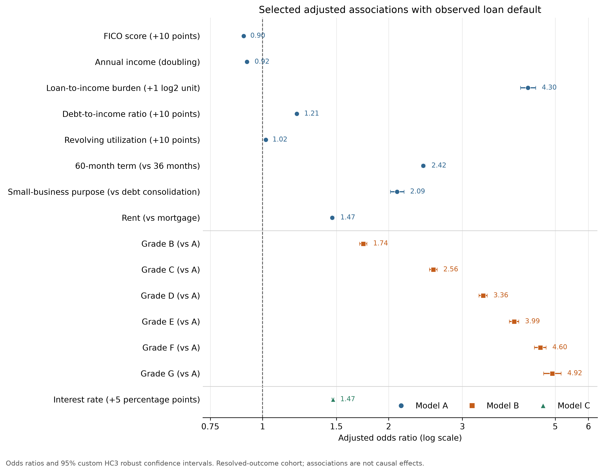

# Member 4 — Statistical Inference Report

**Project:** STAT5106 Lending Club Loan Default
**Analysis:** Prespecified feature engineering, adjusted association inference, and uncertainty
**Population:** Cleaned resolved-outcome loans

## 1. Question and estimand

This analysis asks which application/origination-time borrower and loan characteristics are
independently associated with the odds of observed default. Estimates are adjusted odds ratios
from prespecified binomial GLMs. They are associations within the resolved-outcome cohort, not
causal effects and not measures of predictive accuracy.

The feature, missing-data, sparse-category, multiplicity, and sensitivity rules were frozen in
`report/member4_inference_specification.md` before fitting.

## 2. Analysis sample

The cleaned cohort contained 1,348,099 resolved loans. The primary inference cohort retained
1,347,201 loans after excluding
898 rows missing one of the prespecified
complete-case fields. It contained 269,174 defaults
(19.98%).

Missing employment length was median-imputed with a missingness indicator in the primary
models. The employment complete-case sensitivity excluded
78,499 additional rows. Purpose levels
`educational` and `renewable_energy`, and home-ownership levels `ANY`, `NONE`, and `OTHER`,
were combined into `OTHER_RARE` using the frozen frequency rule.

## 3. Methods

- Model A includes prespecified borrower, credit, loan/application, and issue-year terms without
  a lender risk-pricing proxy.
- Model B adds categorical loan grade.
- Model C adds interest rate instead of grade.
- Primary continuous features were winsorized at the 0.5th and 99.5th percentiles without using
  the outcome; an unwinsorized Model A was fitted separately.
- Uncertainty uses an explicitly computed, chunked GLM HC3 score-sandwich covariance.
- Coefficient tests and feature-family Wald tests use separate Benjamini-Hochberg FDR
  corrections within each model.
- No stepwise selection or outcome-driven category merging was used.

## 4. Primary adjusted associations

Model A used 1,347,201 loans and 44 parameters.

| Characteristic | Adjusted OR (95% HC3 CI) | BH q-value |
| --- | ---: | ---: |
| FICO score, per 10 points | 0.901 (0.899–0.903) | <1e-300 |
| Annual income, per doubling | 0.917 (0.910–0.924) | 2.34e-97 |
| Loan-to-income burden, per +1 log2 unit | 4.303 (4.129–4.486) | <1e-300 |
| Debt-to-income ratio, per 10 points | 1.207 (1.200–1.215) | <1e-300 |
| Revolving utilization, per 10 points | 1.018 (1.015–1.020) | 2.13e-48 |
| Credit-history length, per year | 0.991 (0.990–0.992) | 1.23e-140 |
| Delinquencies in previous two years, per event | 1.033 (1.027–1.039) | 2.34e-28 |
| Inquiries in previous six months, per inquiry | 1.188 (1.182–1.193) | <1e-300 |
| Open accounts, per five accounts | 1.039 (1.034–1.044) | 4.14e-54 |
| Derogatory public records, per record | 1.020 (1.011–1.030) | 1.33e-05 |
| 60-month term versus 36 months | 2.420 (2.394–2.446) | <1e-300 |
| Small-business versus debt-consolidation purpose | 2.095 (2.017–2.175) | <1e-300 |
| Rent versus mortgage | 1.467 (1.452–1.482) | <1e-300 |

Loan purpose was jointly associated with default
(Wald χ²=4345.0, df=12,
q=<1e-300). In particular, small-business purpose had
substantially higher adjusted odds than debt consolidation.

Employment length itself was not distinguishable from no association after coefficient-level
FDR correction (OR 0.999 (0.997–1.000), q=0.055).
The combined nonpositive-income/DTI-missing indicator was also not distinguishable from no
association (OR 0.951 (0.720–1.255), q=0.721).

## 5. Lender risk-pricing specifications

### Model B — grade

| Grade contrast | Adjusted OR (95% HC3 CI) | BH q-value |
| --- | ---: | ---: |
| Grade B versus Grade A | 1.738 (1.703–1.774) | <1e-300 |
| Grade C versus Grade A | 2.556 (2.502–2.610) | <1e-300 |
| Grade D versus Grade A | 3.360 (3.284–3.438) | <1e-300 |
| Grade E versus Grade A | 3.986 (3.884–4.090) | <1e-300 |
| Grade F versus Grade A | 4.602 (4.455–4.754) | <1e-300 |
| Grade G versus Grade A | 4.918 (4.686–5.161) | <1e-300 |

The monotonic grade gradient remained after adjustment for the other prespecified borrower and
loan characteristics. These estimates condition on a lender-assigned risk category and are not
causal grade effects.

### Model C — interest rate

| Interest-rate contrast | Adjusted OR (95% HC3 CI) | BH q-value |
| --- | ---: | ---: |
| Interest rate, per five percentage points | 1.472 (1.463–1.481) | <1e-300 |

Grade and interest rate were deliberately fitted in separate models because both encode lender
risk assessment.

## 6. Sensitivity analyses

The maturity sensitivity retained 675,884 loans whose contractual term would have
ended by 2018-12-31; its observed default rate was 14.86%. Directional
conclusions for the core continuous predictors were retained, although magnitudes changed.

| Scenario | Characteristic | Adjusted OR (95% HC3 CI) |
| --- | --- | ---: |
| primary | FICO +10 points | 0.901 (0.899–0.903) |
| primary | Income doubling | 0.917 (0.910–0.924) |
| primary | Loan-to-income +1 log2 unit | 4.303 (4.129–4.486) |
| primary | DTI +10 points | 1.207 (1.200–1.215) |
| primary | Revolving utilization +10 points | 1.018 (1.015–1.020) |
| mature | FICO +10 points | 0.893 (0.890–0.896) |
| mature | Income doubling | 0.874 (0.863–0.885) |
| mature | Loan-to-income +1 log2 unit | 3.425 (3.212–3.653) |
| mature | DTI +10 points | 1.177 (1.166–1.189) |
| mature | Revolving utilization +10 points | 1.012 (1.009–1.016) |
| unwinsorized | FICO +10 points | 0.904 (0.902–0.906) |
| unwinsorized | Income doubling | 0.884 (0.876–0.892) |
| unwinsorized | Loan-to-income +1 log2 unit | 3.180 (3.011–3.359) |
| unwinsorized | DTI +10 points | 1.110 (1.097–1.124) |
| unwinsorized | Revolving utilization +10 points | 1.026 (1.023–1.028) |
| employment_complete_case | FICO +10 points | 0.898 (0.896–0.900) |
| employment_complete_case | Income doubling | 0.925 (0.917–0.933) |
| employment_complete_case | Loan-to-income +1 log2 unit | 4.541 (4.348–4.743) |
| employment_complete_case | DTI +10 points | 1.215 (1.207–1.223) |
| employment_complete_case | Revolving utilization +10 points | 1.015 (1.012–1.017) |

The difference between winsorized and unwinsorized loan-burden/DTI estimates shows that extreme
values materially affect magnitude. Results should therefore be interpreted using the
prespecified primary model together with the sensitivity range, not a single coefficient alone.

## 7. Diagnostics

All six models converged. No HC3 leverage denominator required clipping. Standardized condition
numbers and approximate VIFs did not indicate severe multicollinearity.

| Scenario | Model | n | Iterations | Condition number | Maximum VIF | Maximum leverage |
| --- | --- | ---: | ---: | ---: | ---: | ---: |
| primary | A | 1,347,201 | 5 | 2.74 | 1.77 | 0.0055 |
| primary | B | 1,347,201 | 6 | 4.22 | 2.76 | 0.0057 |
| primary | C | 1,347,201 | 5 | 3.00 | 1.97 | 0.0054 |
| mature | A | 675,884 | 6 | 2.77 | 1.77 | 0.0097 |
| unwinsorized | A | 1,347,201 | 6 | 2.62 | 1.69 | 0.0254 |
| employment_complete_case | A | 1,268,702 | 5 | 2.72 | 1.71 | 0.0057 |

Selected adjusted associations are summarized below; the complete coefficient and global-test
tables remain the source of truth.



## 8. Limitations

- The cohort excludes current, late, grace-period, missing, and unknown statuses. Selection into
  a resolved status is especially problematic for recent loan vintages.
- The mature-loan restriction reduces but cannot fully remove outcome-observation and historical
  cohort differences.
- The models are associational and may remain affected by unmeasured confounding, functional-form
  misspecification, and Lending Club's own underwriting process.
- Very large sample size makes small effects statistically detectable; effect magnitude,
  uncertainty, and sensitivity are more important than significance alone.
- Grade and interest rate are lender-assigned summaries, not manipulable causal exposures.
- Predictive discrimination, calibration, thresholds, and out-of-time performance belong to the
  downstream modelling and validation tasks and are not reported here.

## 9. Reproduction

From the repository root:

```bash
python analysis/03_inference_member4.py \
  --input data/cleaned/clean_v1/lending_club_clean.csv.gz
```

Auditable outputs:

- `outputs/tables/inference_odds_ratios.csv`
- `outputs/tables/inference_global_tests.csv`
- `outputs/tables/inference_sample_summary.csv`
- `outputs/tables/inference_preprocessing.json`
- `outputs/tables/feature_specification.csv`
- `outputs/figures/inference_forest_plot.png`
- `report/member4_inference_report.md`

The downstream modelling owner must estimate preprocessing values and category maps on the
temporal training partition rather than reusing the full-cohort inference values.
